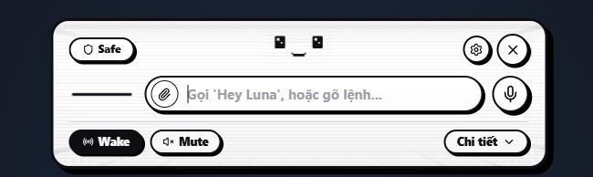
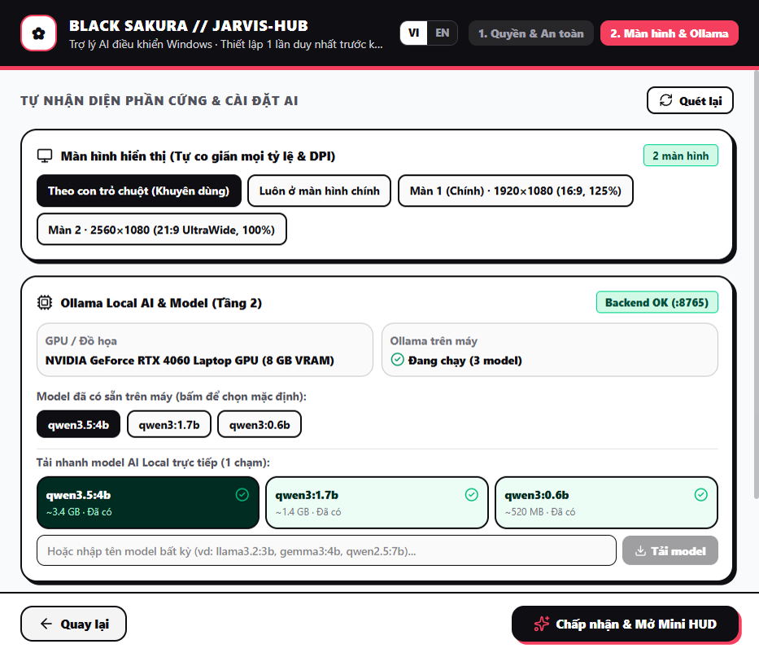
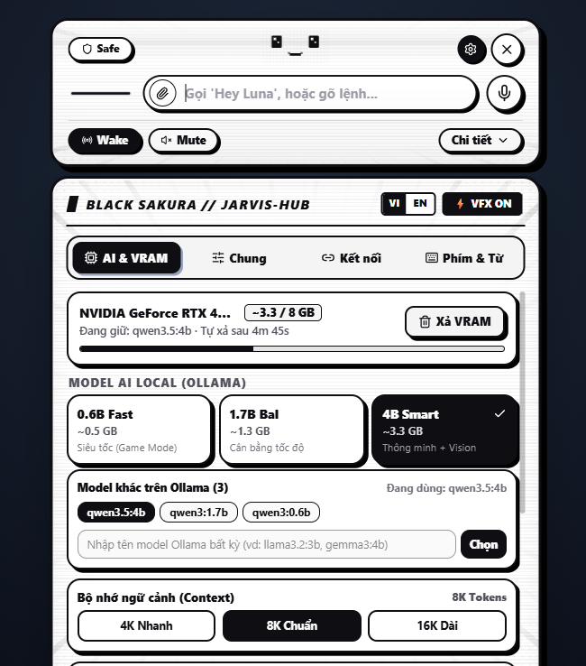
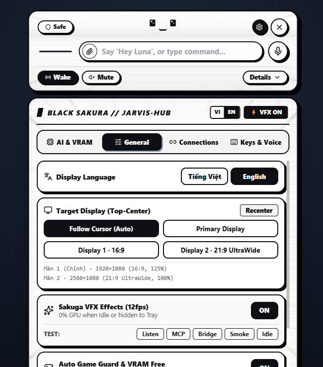
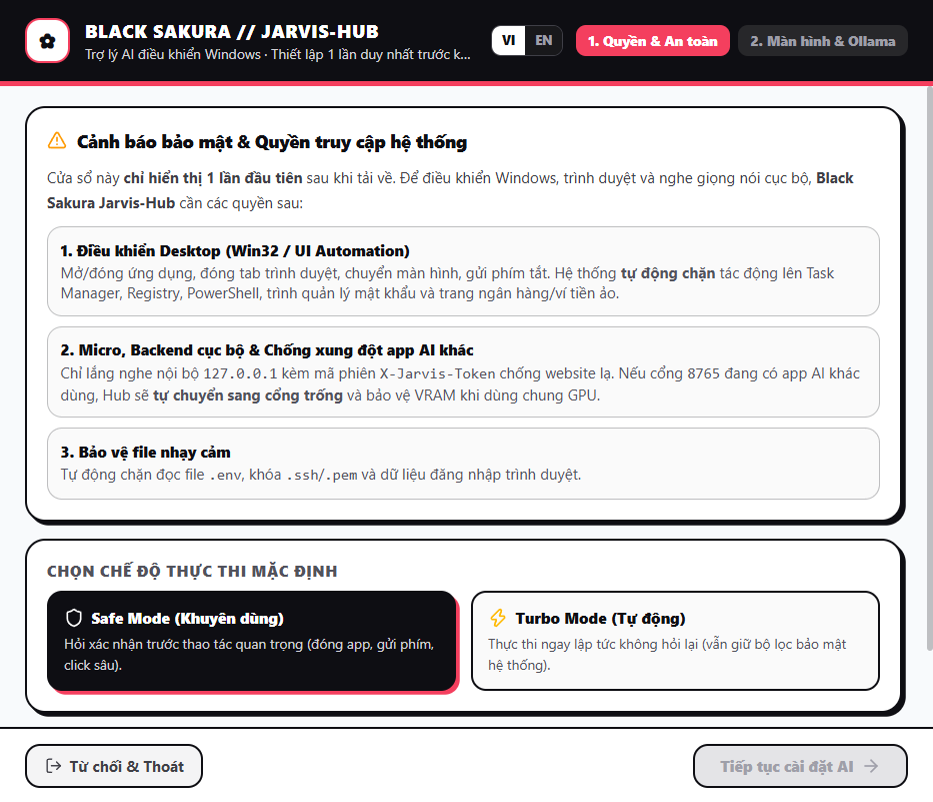

# Black Sakura Jarvis-Hub

Trợ lý AI điều khiển máy tính Windows ưu tiên chạy nội bộ (**Local-First**, **Zero-VRAM Fast-Path**), kết hợp **Win32/UIA tốc độ cao (<50ms)**, **bất kỳ model Ollama nào**, **nhận diện giọng nói Faster-Whisper**, **MCP (`fast-desktop`, `agent-desktop`, `playwright`)**, và giao diện nổi **Electron + React HUD** phong cách manga Sakuga.

> Hỗ trợ **mọi cấu hình máy Windows 10/11**: máy có GPU NVIDIA (4GB–24GB+), máy chỉ có **CPU / card onboard**, máy **chưa cài Ollama** (chạy Tầng 1 điều khiển tức thì + tùy chọn Cloud Gemini API), **chống xung đột cổng & bảo vệ VRAM khi chạy song song app AI khác**, và hỗ trợ **chuyển ngôn ngữ giao diện Tiếng Việt / English**.

---

## Ảnh chụp giao diện thực tế (Screenshots)

| Floating Mini HUD (Spotlight Bar) | Setup Wizard lần đầu & Cài Ollama 1 chạm |
| :---: | :---: |
|  |  |

| Quản lý AI & VRAM + Chọn bất kỳ Model Ollama | Giao diện Tiếng Anh & Nhận diện đa màn hình / DPI |
| :---: | :---: |
|  |  |

<details>
<summary>Xem thêm màn hình Cảnh báo bảo mật & Quyền truy cập lần đầu (Step 1 Setup Wizard)</summary>



</details>

---

## Tính năng nổi bật

- **Kiến trúc định tuyến 3 tầng (3-Tier Routing — Tầng cuối là Cloud API Key):**
  - **Tầng 1 — Fast-Path Win32/UIA (`<50ms`, `0 MB VRAM`):** Mở/đóng app & tab web (Edge, Chrome, Brave, Cốc Cốc, Firefox, Opera), đóng cả tab lẫn app (`"đóng cả hai cái facebook mới mở"`), chuyển màn hình 1/2/màn còn lại, phóng to/thu nhỏ cửa sổ đang focus, tăng/giảm âm lượng & độ sáng, điều khiển nhạc, tìm kiếm YouTube/Google, tua video, lệnh ghép (`"rồi"`, `"và"`).
  - **Tầng 2 — Local AI Agent (Ollama):** Tự động nhận diện **mọi model đã cài trên Ollama** (`qwen3.5:4b`, `qwen3:1.7b`, `qwen3:0.6b`, `llama3.2:3b`, `gemma3:4b`, `qwen2.5:7b`...), tự động lọc gọn tool theo ngữ cảnh, nén cây UI, và quản lý VRAM thông minh (`0s`, `1m`, `2m`, `5m`, `15m`, `always` + Game Mode tự xả VRAM).
  - **Tầng 2.5 — Vision Click dự phòng:** Lưới 10×10 miễn phí VRAM hoặc bật **OmniParser V2** (lazy-load vào VRAM chỉ lúc UIA bấm trượt).
  - **Tầng 3 (Tầng cuối) — Cloud Gemini API Key (Tùy chọn, tắt mặc định):** Xử lý các tác vụ nhiều bước / ca khó khi AI Local không đáp ứng hoặc máy chưa cài Ollama — chỉ cần nhập `GEMINI_API_KEY` trong Cài đặt hoặc `.env`.
- **Chạy tốt kể cả khi chưa cài Ollama:** Tầng 1 điều khiển Windows/trình duyệt chạy ngay lập tức mà không cần Ollama hay GPU rời; khi cần suy luận sâu có thể bật Cloud Gemini API hoặc cài Ollama sau.
- **Tự nhận diện màn hình, tỷ lệ khung hình & DPI:** Tự phát hiện độ phân giải gốc, tỷ lệ màn hình (`16:9`, `16:10`, `21:9 UltraWide`, `32:9`, `3:2`, `4:3`, màn dọc `Portrait`) và mức DPI scale trên nhiều màn hình để tự căn chỉnh tỷ lệ zoom/khung HUD không bị cắt chữ.
- **Cửa sổ Thiết lập ban đầu (First-Run Setup Wizard):** Lần đầu mở app sẽ hiện cửa sổ thiết lập hoàn chỉnh (hỏi xác nhận quyền điều khiển & cảnh báo bảo mật, chọn chế độ Safe/Turbo, hiển thị thông số màn hình/GPU/Backend/Ollama tự quét, hỗ trợ tải Ollama / nhập Cloud Gemini API Key) trước khi thu gọn thành Mini HUD nổi trên màn hình.
- **Đóng gói 1 file ZIP Portable `.exe` tiện tải:** Tải 1 gói duy nhất từ [GitHub Releases](https://github.com/hohieu112007-byte/black-sakura-jarvis-hub/releases/latest) hoặc tự build bằng `build_exe.bat` để tạo **`BlackSakuraJarvisHub.exe`** + file `.zip` portable.

---

## Bảo mật (Security-First)

- **Chống CSRF & DNS Rebinding cho Backend Local (`127.0.0.1:8765`):**
  - Kiểm tra chặt `Host` và `Origin`, từ chối mọi request từ trang web bên ngoài (`403`).
  - Xác thực `X-Jarvis-Token` sinh ngẫu nhiên theo phiên (`backend/.session_token`) trên toàn bộ API thực thi/ghi cấu hình (`401`).
- **Bảo vệ hệ thống & dữ liệu nhạy cảm:**
  - Chặn tự động hóa vào các cửa sổ/tiến trình nhạy cảm (`Taskmgr`, `regedit`, `powershell`, `cmd`, trình quản lý mật khẩu, trang ngân hàng/ví tiền ảo).
  - Chặn đọc các file nhạy cảm (`.env`, `.session_token`, SSH/cloud key, thư mục dữ liệu đăng nhập của Chrome/Edge/Firefox).
  - Cách ly dữ liệu giao diện bằng thẻ `<untrusted_ui_data>` chống Prompt Injection và truyền dữ liệu TTS qua biến môi trường chống PowerShell Injection.
- **Chế độ Safe / Turbo & Panic Stop:** Có hộp thoại duyệt thao tác ở chế độ Safe và nút ngắt khẩn cấp.

---

## Cài đặt nhanh (Windows 10/11)

### Cách nhanh nhất: Tải 1 gói Portable `.zip` (có sẵn `BlackSakuraJarvisHub.exe`)
1. Tải file **`Black-Sakura-Jarvis-Hub-v1.0.0-Windows-Portable.zip`** tại **[GitHub Releases](https://github.com/hohieu112007-byte/black-sakura-jarvis-hub/releases/latest)** và giải nén.
2. *(Chỉ làm 1 lần)* Cài thư viện Python: `pip install -r requirements.txt` (cần Python 3.10+).
3. Bấm đúp **`BlackSakuraJarvisHub.exe`** — cửa sổ **Setup Wizard** sẽ tự mở để hướng dẫn quyền, kiểm tra màn hình/GPU/Ollama và cấu hình trước khi thu gọn thành Mini HUD.

---

### Cách 2: Chạy từ mã nguồn (Developer)

Xem hướng dẫn chi tiết từng bước (bao gồm máy chưa có Ollama, máy không có GPU rời, và đổi model) tại **[docs/SETUP_GUIDE.md](docs/SETUP_GUIDE.md)**.

### Yêu cầu cơ bản
- **Windows 10 / 11 (64-bit)**
- **Python 3.10+** (khuyến nghị 3.12)
- **Node.js 18+**
- *(Tùy chọn)* **Ollama** ([ollama.com](https://ollama.com)) nếu muốn dùng AI Local Tầng 2

### Bước 1: Tải mã nguồn & cài thư viện
```bash
git clone https://github.com/hohieu112007-byte/black-sakura-jarvis-hub.git
cd black-sakura-jarvis-hub

# Cài thư viện Python (khuyến nghị tạo môi trường ảo .venv)
python -m venv .venv
.venv\Scripts\activate
pip install -r requirements.txt

# Cài thư viện & build giao diện Electron HUD
cd jarvis-hub
npm install
npm run build
cd ..
```

### Bước 2: *(Tùy chọn)* Cấu hình `.env` & Ollama
```bash
copy .env.example .env
```
- **Nếu dùng Ollama Local:** Tải ít nhất 1 model phù hợp máy bạn (ví dụ):
  ```bash
  ollama pull qwen3.5:4b      # Khuyến nghị cho GPU 6–8GB+
  # Hoặc model nhẹ cho máy yếu / CPU:
  ollama pull qwen3:1.7b
  ollama pull qwen3:0.6b
  # Hoặc bất kỳ model nào bạn thích (llama3.2:3b, gemma3:4b, qwen2.5:7b...)
  ```
- **Nếu CHƯA cài Ollama:** Bỏ qua bước trên. Tầng 1 vẫn chạy ngay, và bạn có thể dán `GEMINI_API_KEY` vào `.env` (hoặc trong Settings của HUD) để bật Cloud Gemini API dự phòng.

### Bước 3: Khởi chạy
- **Cách 1 (Chạy trực tiếp từ mã nguồn):**
  1. Chạy `start_backend.bat` (khởi động FastAPI `127.0.0.1:8765`, tự nhận Ollama nếu có).
  2. Chạy `cd jarvis-hub && npm start` (hoặc mở `jarvis-hub\Launch-JarvisHub.vbs`).
- **Cách 2 (Đóng gói thành file `.exe` portable cho tiện):**
  ```bat
  build_exe.bat
  ```
  Sau khi build xong, mở **`dist-exe\Black-Sakura-Jarvis-Hub\BlackSakuraJarvisHub.exe`**!

---

## Cấu trúc thư mục

```text
black-sakura-jarvis-hub/
├── backend/                  # FastAPI server, 3-tier VRAM router, daily scenarios, Win32 native, STT/TTS
├── fast-desktop-mcp/         # MCP server điều khiển Windows/UIA/Edge/Word (Node.js + PowerShell, 0 deps)
├── jarvis-hub/               # Giao diện nổi Electron + React + Tailwind + script đóng gói .exe
├── docs/                     # Hướng dẫn cài đặt (SETUP_GUIDE.md) & mẫu GitHub Actions build .exe
├── start_backend.bat         # Khởi chạy Backend (tự tìm .venv / Python 3.10–3.13 & Ollama)
├── build_exe.bat             # Đóng gói nhanh BlackSakuraJarvisHub.exe
├── requirements.txt          # Danh sách thư viện Python
└── .env.example              # Mẫu biến môi trường (tuyệt đối không commit file .env thật)
```

---

## Đóng góp & Giấy phép

- Xem hướng dẫn đóng góp tại [CONTRIBUTING.md](CONTRIBUTING.md).
- Dự án phát hành theo giấy phép **MIT** — xem [LICENSE](LICENSE).
